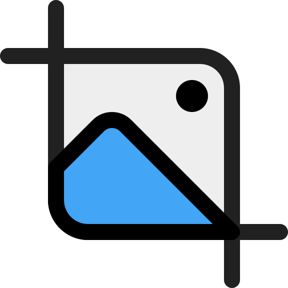
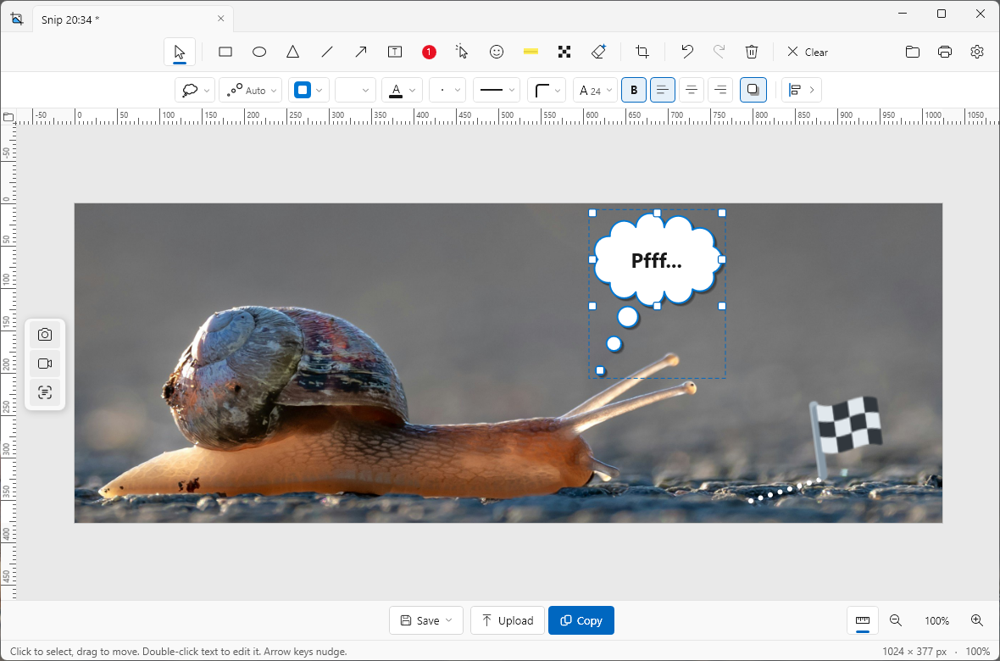

<p align="center">
  
</p>

# kniip

**kniip** is a full-featured annotation editor for Windows. Capture something on your screen, make it clear with annotations and share it as an image, video, GIF or link.

<p align="center">
  <a href="https://github.com/R0GGER/kniip/releases/latest"><strong>Download: kniip</strong></a>
</p>

---

<p align="center">
  <b>English</b> . <a href="README_NL.md">Nederlands</a>
</p>

**kniip** is an annotation editor that works alongside the Windows Snipping Tool. Take a screenshot, add arrows, text, highlights, steps, emoji or blur, and save, copy or upload the result. kniip can also record your screen and export the recording as a video or GIF.

**kniip** started as a Dutch initiative, and its name gives that away: it comes from the Dutch *knip* and *knippen*, meaning "cut" and "cutting", which suits a tool built around snipping your screen. The original Dutch version of this page is in [README_NL.md](README_NL.md).



## What can kniip do?

- **Pixel-perfect snips.** Rectangle or window, with a magnifier for precise corners and an adjustable delay so you can open a menu or tooltip first.
- **Annotate.** Arrows and lines you can bend, text, shapes, numbered steps, highlighter, emoji and blur.
- **Tabs.** Every snip opens as a tab in one editor window. When closing, you choose whether the tabs close or are kept.
- **Screencasts.** Record part of your screen and export it as a video or GIF.
- **Share.** Save, copy to the clipboard, print, or upload and share the link right away.
- **History.** Find earlier snips and uploads again, with thumbnails and search.
- **Your toolbar.** Choose one or two toolbars, drag buttons around and hide what you don't use.
- **Always up to date.** **kniip** tells you when a new version is available and updates itself with one click.
- **English and Dutch.** **kniip** follows the Windows display language, or you choose the language under **Settings > System > Language**.

## Download

| Version | Installer |
| ------- | --------- |
| 2.5.1 | [Kniip-Setup-2.5.1.exe](https://github.com/R0GGER/kniip/releases/download/2.5.1/Kniip-Setup-2.5.1.exe) |

Older versions are available under [all releases](https://github.com/R0GGER/kniip/releases).

## Install

1. Download `Kniip-Setup-<version>.exe` via one of the links above.
2. Run the installer. No administrator rights are needed: kniip is installed per user in `%LOCALAPPDATA%\Programs\Kniip`.
3. During installation, choose which integrations you want:
   - **Start kniip with Windows** (recommended): kniip then runs in the background in the system tray.
   - **Show kniip in 'Open with'** for images (`.png`, `.jpg`, `.jpeg`, `.bmp`, `.gif`), also from the Snipping Tool.
   - **Desktop shortcut**.

You can also turn both integrations on or off later in the kniip settings.

A separate .NET installation is not needed; the installer contains everything kniip needs.

### System requirements

- Windows 10 (version 1809 or newer) or Windows 11
- 64-bit (x64)

### Uninstall

Uninstall **kniip** via **Settings > Apps > Installed apps**. Autostart and the 'Open with' registration are cleaned up as well.

If you only ran `Kniip.exe` and never used the installer, **kniip** may still be listed under **Settings > Apps > Startup**. That entry points to the folder where the exe was at the time. Turning off the switch there doesn't hide **kniip**: Windows keeps the entry and only sets it to off.

`tools\remove-autostart.cmd` removes the entry. Double-click the file, or run:

```powershell
powershell -NoProfile -ExecutionPolicy Bypass -File .\tools\remove-autostart.ps1
```

The script applies to the signed-in user. The path of the exe doesn't matter and the file no longer needs to exist. No administrator rights are needed. Every Windows account has its own startup list, so run it in the account in which **kniip** was started. If the entry is still visible afterwards, sign out and back in once.

## Build it yourself

Requirements:

- [.NET 8 SDK](https://dotnet.microsoft.com/download/dotnet/8.0)
- [Inno Setup 6](https://jrsoftware.org/isinfo.php) (optional, only needed for the installer): `winget install JRSoftware.InnoSetup`

Build:

```powershell
.\build.ps1                  # version 2.5.1
.\build.ps1 -Version 1.2.0   # another version
```

The script produces (older versions in `public\` are removed first):

- `public\Kniip-Setup-<version>.exe`: the installer (only if Inno Setup 6 is found)
- `public\KniipTest-<version>.exe`: test build (skip with `-SkipTest`)
- `obj\publish\Kniip.exe`: standalone exe, runs without installation

### Test build

The test build runs alongside the installed kniip and doesn't touch it. It uses `KniipTest` instead of `Kniip` everywhere: the autostart entry, the 'Open with' registration (`KniipTest.Image`), the settings folder `%APPDATA%\KniipTest` and the single-instance mutex. On first start it copies the settings of the regular kniip. It doesn't update itself, because the installer would overwrite the regular kniip.

You only need to clean up if you turned on autostart or 'Open with' in the test build:

```powershell
.\public\KniipTest-<version>.exe --unregister
Remove-Item "$env:APPDATA\KniipTest" -Recurse   # optional: settings of the test build
```

If both versions run at the same time, they both respond to the same keyboard shortcuts and snips. Close the regular kniip while testing, or choose different shortcuts in the test build.

## Publishing a new version

1. Write the changes at the top of [CHANGELOG.md](CHANGELOG.md) under a new heading `## <version> - <date>`, for example `## 2.3.4 - 2026-11-13`.
2. Commit and push to `master`.
3. On GitHub, start **Actions > Release > Run workflow** and enter the version, without `v`. Check **dry_run** to do a trial run first; the run summary then shows the release text and the README changes, without committing anything.
4. The [Release](.github/workflows/release.yml) workflow builds the installer and test build to `public/`, sets the download line under [Download](#download) in `README.md` and `README_NL.md` to the new version, commits both to `master` and creates a draft release with the version as tag and title, the changelog section as description and `Kniip-Setup-<version>.exe` attached.
5. Check the draft on [GitHub](https://github.com/R0GGER/kniip/releases) and click **Publish release**. Only then does the tag exist and does the download link work.
6. Pull locally afterwards, because the workflow has pushed a commit to `master`.

You can also build locally with `.\build.ps1 -Version <version>`.

### Updating from within kniip

Under **Settings > Update**, **kniip** uses the GitHub API to check for a newer release and shows the changelog of all newer versions. **Update** downloads the installer, closes **kniip**, installs silently and restarts **kniip**. Previously chosen integrations are kept.

**kniip** also checks by itself at startup and then every 24 hours. If there's a newer version, a dot appears on the **kniip** icon in the system tray, on the **Settings** button in the editor and on the **Update** tab. Hover over the icon in the system tray to see which version is ready. Turn this off with **Automatically check for new versions** in that tab.

## License

Copyright © 2026 Rogier Meijer

**kniip** is free software: you can redistribute it and/or modify it under the terms of the [GNU General Public License](LICENSE) as published by the Free Software Foundation, either version 3 of the License, or (at your option) any later version. kniip is distributed without any warranty; see the [license](LICENSE) for details.

**kniip** uses [Markdig](https://github.com/xoofx/markdig) (BSD-2-Clause), [ScreenRecorderLib](https://github.com/sskodje/ScreenRecorderLib) (MIT) and [Twemoji](https://github.com/jdecked/twemoji) (CC-BY 4.0). See [`NOTICE.txt`](src/Kniip/Assets/Emoji/NOTICE.txt) for the origin of the emoji.
