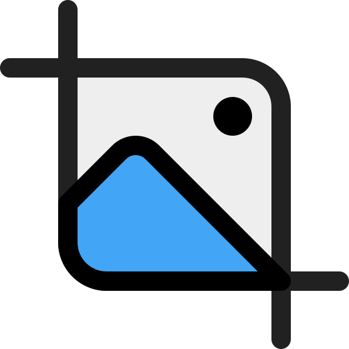
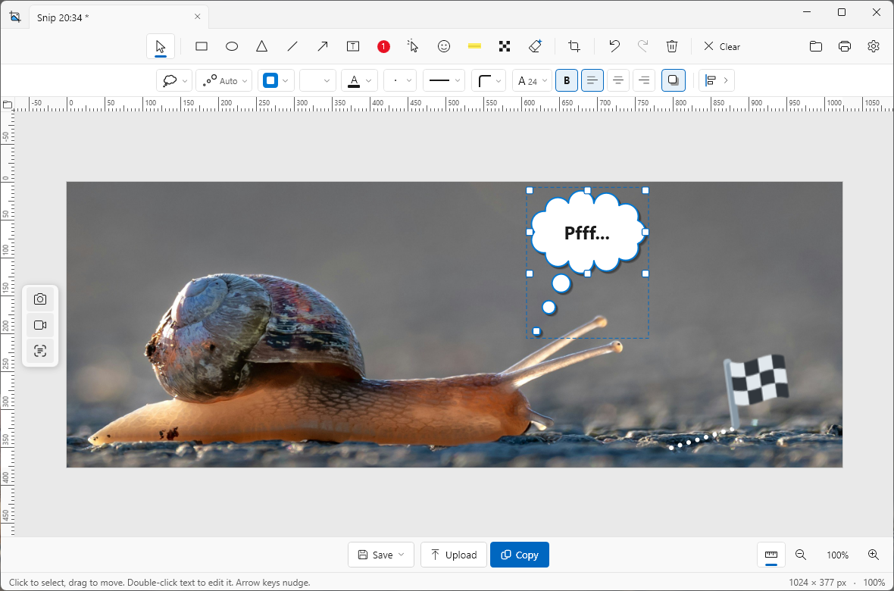

<p align="center">
  
</p>

<h1 align="center">kniip</h1>

<p align="center">
  <b>kniip</b> is een uitgebreide annotatie-editor voor Windows. Leg iets op je scherm vast, maak het duidelijk met annotaties en deel het als afbeelding, video, GIF of link.
</p>

<p align="center">
  <a href="https://github.com/R0GGER/kniip/releases/latest"><strong>Download: kniip</strong></a>
</p>

<p align="center">
  <a href="README.md">English</a> · <b>Nederlands</b>
</p>

---

kniip is een annotatie-editor die naast het Windows Knipprogramma werkt. Maak een schermafbeelding, voeg pijlen, tekst, markeringen, stappen, emoji of vervaging toe en sla het resultaat op, kopieer het of upload het. kniip kan ook schermopnames maken en die exporteren als video of GIF.

<p align="center">
  <a href="images/kniip.png"></a>
</p>

## Wat kan kniip?

- **Knippen tot op de pixel.** Rechthoek of venster, met een vergrootglas voor precieze hoeken en een instelbare vertraging om eerst een menu of tooltip te openen.
- **Aantekenen.** Pijlen en lijnen die je kunt buigen, tekst, vormen, genummerde stappen, markeerstift, emoji en vervaging.
- **Tabbladen.** Elk knipsel opent als tabblad in één editorvenster. Bij het sluiten kies je of de tabbladen dicht gaan of bewaard blijven.
- **Screencasts.** Neem een deel van je scherm op en exporteer als video of GIF.
- **Delen.** Opslaan, kopiëren naar het klembord, printen of uploaden en de link meteen delen.
- **Geschiedenis.** Vind eerdere knipsels en uploads terug, met miniaturen en zoeken.
- **Jouw werkbalk.** Kies een of twee werkbalken, versleep knoppen en verberg wat je niet gebruikt.
- **Altijd bij.** kniip meldt zelf wanneer er een nieuwe versie is en werkt zichzelf bij met een klik.

## Downloaden

| Versie | Installer |
| ------ | --------- |
| 2.5.1 | [Kniip-Setup-2.5.1.exe](https://github.com/R0GGER/kniip/releases/download/2.5.1/Kniip-Setup-2.5.1.exe) |

Oudere versies vind je bij [alle releases](https://github.com/R0GGER/kniip/releases).

## Installeren

1. Download `Kniip-Setup-<versie>.exe` via een van de links hierboven.
2. Start de installer. Beheerdersrechten zijn niet nodig: kniip wordt per gebruiker geïnstalleerd in `%LOCALAPPDATA%\Programs\Kniip`.
3. Kies tijdens de installatie welke integraties je wilt:
   - **kniip starten met Windows** (aanbevolen): kniip draait dan op de achtergrond in het systeemvak.
   - **kniip tonen in 'Openen met'** voor afbeeldingen (`.png`, `.jpg`, `.jpeg`, `.bmp`, `.gif`), ook vanuit het Knipprogramma.
   - **Snelkoppeling op het bureaublad**.

Beide integraties kun je later ook in- of uitschakelen via de instellingen van kniip.

Een losse .NET-installatie is niet nodig; de installer bevat alles wat kniip nodig heeft.

### Systeemeisen

- Windows 10 (versie 1809 of nieuwer) of Windows 11
- 64-bits (x64)

### Verwijderen

Verwijder kniip via **Instellingen > Apps > Geïnstalleerde apps**. Autostart en de 'Openen met'-registratie worden daarbij ook opgeruimd.

Heb je alleen `Kniip.exe` gestart en geen installer gebruikt, dan staat kniip mogelijk nog bij **Instellingen > Apps > Opstarten**. Die regel wijst naar de map waar de exe toen stond. De schakelaar daar uitzetten verbergt kniip niet: Windows bewaart de regel en zet hem alleen op uit.

`tools\remove-autostart.cmd` haalt de regel weg. Dubbelklik het bestand, of voer uit:

```powershell
powershell -NoProfile -ExecutionPolicy Bypass -File .\tools\remove-autostart.ps1
```

Het script geldt voor de aangemelde gebruiker. Het pad van de exe maakt niet uit en het bestand hoeft er niet meer te staan. Beheerdersrechten zijn niet nodig. Elke Windows-account heeft een eigen opstartlijst, dus draai het in de account waarin kniip een keer is gestart. Blijft de vermelding daarna zichtbaar, log dan een keer uit en weer in.

## Zelf bouwen

Vereisten:

- [.NET 8 SDK](https://dotnet.microsoft.com/download/dotnet/8.0)
- [Inno Setup 6](https://jrsoftware.org/isinfo.php) (optioneel, alleen nodig voor de installer): `winget install JRSoftware.InnoSetup`

Bouwen:

```powershell
.\build.ps1                  # versie 2.5.1
.\build.ps1 -Version 1.2.0   # andere versie
```

Het script levert op (oudere versies in `public\` worden eerst verwijderd):

- `public\Kniip-Setup-<versie>.exe`: de installer (alleen als Inno Setup 6 gevonden is)
- `public\KniipTest-<versie>.exe`: testversie (overslaan met `-SkipTest`)
- `obj\publish\Kniip.exe`: zelfstandige exe, draait zonder installatie

### Testversie

De testversie draait naast de geïnstalleerde kniip en raakt die niet aan. Hij gebruikt overal `KniipTest` in plaats van `Kniip`: de autostartregel, de 'Openen met'-registratie (`KniipTest.Image`), de instellingenmap `%APPDATA%\KniipTest` en de single-instance-mutex. Bij de eerste start kopieert hij de instellingen van de gewone kniip. Zichzelf bijwerken doet hij niet, want de installer zou de gewone kniip overschrijven.

Opruimen hoeft alleen als je in de testversie autostart of 'Openen met' hebt aangezet:

```powershell
.\public\KniipTest-<versie>.exe --unregister
Remove-Item "$env:APPDATA\KniipTest" -Recurse   # optioneel: instellingen van de testversie
```

Draaien beide versies tegelijk, dan reageren ze allebei op dezelfde sneltoetsen en knipsels. Sluit de gewone kniip tijdens het testen, of kies in de testversie andere sneltoetsen.

## Een nieuwe versie publiceren

1. Schrijf de wijzigingen bovenaan [CHANGELOG.md](CHANGELOG.md) onder een nieuwe kop `## <versie> - <datum>`, bijvoorbeeld `## 2.3.4 - 2026-11-13`.
2. Commit en push naar `master`.
3. Start op GitHub **Actions > Release > Run workflow** en vul de versie in, zonder `v`. Vink **dry_run** aan om eerst een proefrun te doen; de samenvatting van de run toont dan de releasetekst en de wijziging in de README, zonder iets te committen.
4. De workflow [Release](.github/workflows/release.yml) bouwt de installer en testversie naar `public/`, zet de downloadregel onder [Downloaden](#downloaden) op de nieuwe versie, commit beide naar `master` en maakt een draft-release met de versie als tag en titel, de changelogsectie als beschrijving en `Kniip-Setup-<versie>.exe` als bijlage.
5. Controleer de draft op [GitHub](https://github.com/R0GGER/kniip/releases) en klik **Publish release**. Pas dan bestaat de tag en werkt de downloadlink.
6. Pull daarna lokaal, want de workflow heeft een commit op `master` gezet.

Lokaal bouwen kan ook met `.\build.ps1 -Version <versie>`.

### Updaten vanuit kniip

Onder **Instellingen > Update** controleert kniip via de API van GitHub of er een nieuwere release is en toont de changelog van alle nieuwere versies. **Updaten** downloadt de installer, sluit kniip, installeert stil en start kniip opnieuw. De eerder gekozen integraties blijven behouden.

kniip controleert ook zelf bij het starten en daarna elke 24 uur. Is er een nieuwere versie, dan staat er een blauwe stip op het kniip-icoon in het systeemvak, op de knop **Instellingen** in de editor en op de tab **Update**. Wijs het icoon in het systeemvak aan om te zien welke versie er klaarstaat. Dit zet je uit met **Automatisch controleren op nieuwe versies** in die tab.

## Licentie

Copyright © 2026 Rogier Meijer

kniip is vrije software: je mag het verspreiden en aanpassen onder de voorwaarden van de [GNU General Public License](LICENSE), versie 3 of (naar keuze) een latere versie, zoals gepubliceerd door de Free Software Foundation. kniip wordt verspreid zonder enige garantie; zie de [licentie](LICENSE) voor de details.

kniip gebruikt [Markdig](https://github.com/xoofx/markdig) (BSD-2-Clause), [ScreenRecorderLib](https://github.com/sskodje/ScreenRecorderLib) (MIT) en [Twemoji](https://github.com/jdecked/twemoji) (CC-BY 4.0). Zie [`NOTICE.txt`](src/Kniip/Assets/Emoji/NOTICE.txt) voor de herkomst van de emoji.
